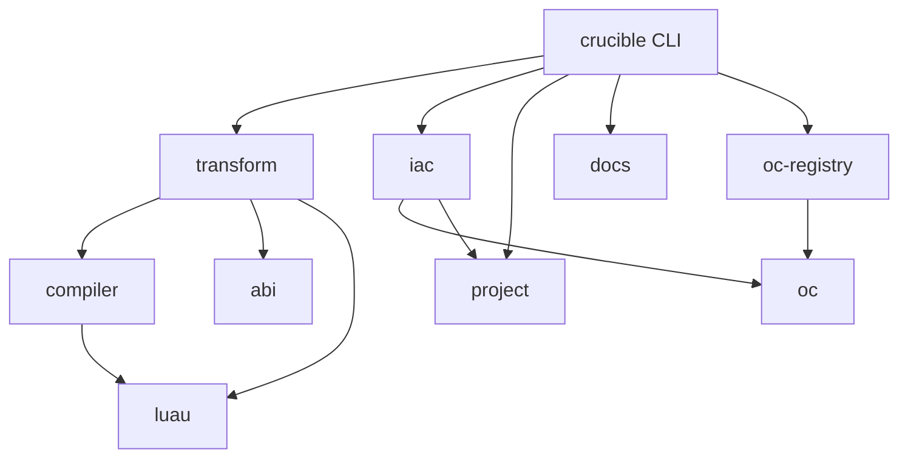

# Crucible architecture

Crucible becomes four products with hard edges: a game framework, a compiler, an infrastructure-as-code (IaC) engine, and a command line that composes them. Each lives in its own crates or package, and a check in CI rejects a dependency edge the design does not allow. The compiler stops knowing Crucible's names, and the framework's transform plugs into it through one internal extension trait. The runtime ABI between the transform and the framework gets one source of truth instead of matching strings in Rust and TypeScript. IaC adds declared products, badges, passes and experience settings to `crucible.toml`, records Roblox's IDs in a committed `crucible.lock`, and hands game code typed handles, never raw IDs. Every refactor step keeps the emitted Luau byte-identical, and the riskiest protocols get TLA+ models before code. This document records the audit at `2ead6cd` on 2026-11-06, the target design, the pitfalls, and the order of work. It replaces two settled decisions in `design/compiler.md`, the absence of a plugin seam and the transform living inside the compiler. `design/stack.md` records the libraries the framework builds on, Charm for state and Vide for UI, and the UI code that is deleted instead of moved.

## What the audit found

Five read-only audits covered the compiler crate, the CLI crate and Open Cloud layer, the runtime package, the contracts between them, and prior art for IaC. The findings below carry file and line evidence from the audited HEAD.

### The compiler knows the framework by name

`cli/crates/compiler` holds a generic TypeScript-to-Luau compiler, a Roblox backend, Crucible's transform, the UI class compiler and a Rojo resolver in one crate. About twenty places in generic lowering branch on framework knowledge. Examples are the `MacroKind::Crucible` dispatch in `src/lower/call.rs:302`, the `Crucible::Load` string case in `src/lower/expr.rs:51`, registration appended after ordinary class emission in `src/lower/class.rs:141`, and the `uses_crucible` flag in `src/lower/mod.rs:58`. The UI class compiler and its import flag are deleted, not moved, as `design/stack.md` records. The core `Fact` and `Jsx` types carry Crucible schema and style types (`src/facts.rs:43`, `:177`). The macro enum mixes generic compiler macros with fourteen framework macros (`src/macros.rs:159`). `design/compiler.md:152` made this deliberate. No seam exists that a transform could plug into, because `Api` and `Extractor` are private concrete types and public `Facts` cannot be fed to lowering.

### The runtime ABI lives as matching strings

The transform emits calls into `@trioforge/crucible/emit`: `defineClass`, `resolve`, `resolveAll`, `attribute`, `receive`, each declaration macro, the `n` schema keys and the `t` checker keys (`src/lower/crucible.rs:29` to `:243`). The runtime declares the other half in `packages/crucible/src/emit/index.ts:12` to `:86`. Rust types its half and TypeScript types its half, and nothing checks one against the other. A renamed helper or a reordered positional argument compiles on both sides and breaks every game at run time. The CRU004 import allowlist is also a hard-coded list in the compiler (`src/extract/crucible.rs:1246` to `:1250`), so a new runtime subpath does nothing until someone edits Rust.

### The CLI is one binary with business logic inside

`cli/crates/crucible` is a binary of private modules. The Open Cloud executor needs a `&'static Registry`, the concrete `Output` writer, a `RefCell` acceptance flag and `ureq`, and it sleeps and prints internally (`src/exec.rs:11`, `:40`, `:183`). Business modules derive clap `Args`. `build.rs` mixes compiler calls, child processes, file writes and progress output. `upgrade.rs` is 1,832 lines, of which about 670 are tests, and combines version planning, a versioned snapshot protocol, package.json edits, the roblox-ts migration and process handoff. The pure parts are good and reusable. `outcome.rs:99` is a pure retry and acceptance judge, `manifest.rs:131` parses separately from reading, and `auth.rs:88` chooses a credential separately from loading it.

### Multi-step flows keep their phase in flags

Each multi-step flow keeps its phase in booleans, collections or the file system rather than in a type.

- `crucible publish` sorts places by byte name through a `BTreeMap`, holds progress in a `Vec` that is never persisted, and puts a possibly applied failed upload in its retry command (`src/publish.rs:69`, `:146`).
- Upgrade combines package pins, installed packages, the running binary, the snapshot and template file states into a product state with no journal. An interrupted install can leave new pins, and a rerun can report `Current` without finishing the refresh (`src/upgrade.rs:228`, `:271`).
- Compiler extraction depends on an unencoded pass order (imports first, deferred use decisions, then the framework walk) and on scratch state that must be reset per file (`src/extract/mod.rs:191` to `:248`). The facts vector must stay sorted for binary search, and nothing types that (`src/facts.rs:386`).
- In the runtime, the profile session has a `Phase` enum (Loading, Active, Sealed, Ended at `packages/crucible/src/internal/data/session.ts:19`), but the write and release sub-state inside `Active` and `Sealed` lives in orthogonal fields. Those are `writing`, `carrying`, `releaseWanted` and `releaseAmbiguous`, next to `token`, `epoch` and `safeUntil` (`:78` to `:114`). Receipts encode their stage as membership in three collections (`internal/data/receipts.ts:47`, `:53`, `:170`). The lifecycle core is already an explicit transition engine (`internal/lifecycle.ts:11`, `:180`), so the problem is not everywhere.

### Tests reach across layers through build output

Compiler tests read `packages/crucible/out` and `build/sample-game.rbxl` and only check that they exist, never that they are fresh (`cli/crates/compiler/tests/support/mod.rs:24`, `:58`). The Lune loader intercepts private runtime file names such as `/internal/data/port` (`test/lib/load.luau:152` to `:162`). The `crucible` binary fails to build when a Mermaid block in `docs/` fails to render (`cli/crates/crucible/build.rs:40`). The sample game builds through that binary, and compiler tests read the sample's output, so a docs typo blocks the compiler's tests. The ignored JSX and network execution tests do not run in CI, because CI selects only the lowering suite (`.github/workflows/ci.yml:82`). The release workflow does not require CI to have passed on the tagged commit.

### Churn shows the coupling

Of 103 commits since 2026-09-01, 24 touched three or more of the runtime, compiler, CLI, docs, test and probes folders. UI, random, testing and boot changes each needed the runtime and the compiler together, because of the hard-coded CRU004 allowlist and the emit helpers. Runtime, docs and test triples are healthy, because they are a feature with its evidence.

### No formal verification exists

No proptest, fuzz target, Kani, Loom or TLA+ model exists in the repository. The existing evidence is curated: fact and snapshot tests, Lune execution against built output, golden files for random and spline, recorded Studio and engine probes, and hand-run mutation campaigns under `test/lib/*-mutants.mjs`. The mutation campaigns are good and worth keeping. They prove the tests notice a change, not that a protocol is safe.

## The four products

Each product owns one body of knowledge. The table is the rule a reviewer applies to any new code.

| Product | Owns | Never owns | Ships as |
| --- | --- | --- | --- |
| Framework | Lifecycles, DI, subsystems, behaviours, networking, replication, profile stores, configs, effect lifetimes over Charm values, the `ui` entry on Vide (see `design/stack.md`), the ABI's runtime half, product and badge handle types | Roblox IDs, Open Cloud, file system access, compiler internals | `@trioforge/crucible` |
| Compiler | TypeScript 7 checking through tsrs, lowering to Luau, the roblox-ts RuntimeLib ABI, module resolution against an instance map, virtual modules, the extension trait | Any `@trioforge/crucible` name, `crucible.toml`, Open Cloud | `crucible-compiler`, `crucible-luau` |
| Transform | Framework semantics at compile time: registration, DI IDs, declaration macros and schemas, boot globs, CRU rules | Generic lowering, Rojo, Open Cloud, UI rendering (see `design/stack.md`) | `crucible-transform`, `crucible-abi` |
| IaC | The experience model, the lock file, plan, provision, retirement, Open Cloud typed operations, generated handle types and per-environment bindings | Compiling, building places, game runtime behavior | `crucible-iac`, `crucible-oc` |
| CLI | Commands, argument parsing, output formats, exit codes, docs reader, scaffolding and upgrade, composing build and deploy | Business rules that a library could test without a terminal | `crucible` binary, `@trioforge/crucible-cli` |

The transform is the fourth box's "transformer(s)". It is listed separately because it has its own dependency rule. It may depend on the compiler, and the compiler may never depend on it. `design/stack.md` deletes the UI transform, so the framework transform is the trait's one implementation.

## Target layout

The Cargo workspace moves from `cli/` to the repository root, because a folder named `cli` that holds the compiler is the blur this redesign removes.

```text
Cargo.toml                 workspace
crates/
  luau/                    crucible-luau        Luau AST and printer
  compiler/                crucible-compiler    tsrs frontend, generic lowering, RuntimeLib ABI, virtual modules, Extension trait
  abi/                     crucible-abi         runtime ABI table, generates packages/crucible/src/emit/abi.d.ts
  transform/               crucible-transform   the framework extension and CRU rules
  project/                 crucible-project     crucible.toml model and parser, Rojo project to instance map
  oc/                      crucible-oc          Open Cloud transport, outcome policy, credentials, typed operations
  oc-registry/             crucible-oc-registry the pinned 301-operation spec behind `crucible oc` (see decision 2)
  iac/                     crucible-iac         desired model, lock, plan, provision, codegen
  docs/                    crucible-docs        embedded topics and search (the reader and renderer stay in crates/cli)
  cli/                     crucible             the binary: commands, output, exit codes, build and deploy composition
xtask/                     spec, golden, arch, tla
packages/
  crucible/                @trioforge/crucible  the framework
  compiler-types/          @trioforge/compiler-types
specs/                     TLA+ models
```



These rules hold, and `cargo xtask arch` checks them from `cargo metadata` and a literal scan:

1. `crucible-compiler` and `crucible-luau` contain no `@trioforge`, `crucible/emit`, `__crucible`, `__ui` or framework macro name. They depend on nothing in `crates/` except `crucible-luau`.
2. `crucible-iac` and `crucible-oc` never depend on the compiler, the transform or tsrs.
3. Only `crates/cli` depends on clap, ratatui, syntect, or reads process environment variables. Libraries take values, not `std::env`.
4. `crucible-abi` is the only Rust crate that spells an ABI name. `packages/crucible/src/emit/abi.d.ts` is generated from it, and `cargo xtask abi check` fails when the file is stale.
5. The runtime root `packages/crucible/src/index.ts` never reaches `server`, `client`, `emit` or `testing`, transitively. A TypeScript import check enforces this. Today a Lune spec observes it for the built output only (`test/subpaths.luau:10` to `:11`). A probe of the source import graph during review found no violation, so this rule starts clean.

The first version of `cargo xtask arch` lists today's violations in a file that may only shrink. The program is done when that file is empty.

The runtime stays one npm package with subpath entries. Splitting networking, data and UI into separate npm packages adds release and version work and buys nothing the import check does not.

## The seams

### Compiler and transform meet at one trait

The compiler runs its passes and asks each registered extension at fixed points. The sketch below shows the shape, not the final API. Section "Order of work" schedules a bakeoff of two or three prototypes before anything lands.

```rust
pub trait Extension {
    fn name(&self) -> &'static str;
    fn extract_file(&mut self, cx: &mut ExtractCx<'_>, file: &File<'_>);
    fn finish_program(&mut self, cx: &mut ProgramCx<'_>);
    fn lower_call(&self, cx: &mut LowerCx<'_>, site: Site) -> Option<Expr>;
    fn lower_class_tail(&self, cx: &mut LowerCx<'_>, class: Site) -> Vec<Stmt>;
}
```

- `ExtractCx` exposes checker queries. A facade that hides every tsrs type is probably too costly. Review counted what framework extraction uses today, 27 checker methods, 35 node accessors and 68 syntax kinds, so a facade would re-expose nearly the whole syntax tree. The likelier shape is that the compiler publishes its `tree` view and the transform depends on it, with tsrs pinned in one place. The bakeoff decides.
- Extension facts live in the extension, keyed by site. The generic `Fact` loses its `Crucible`, schema and style variants.
- `LowerCx::helper(module, name)` returns the expression for a helper and records the import as a side effect. That deletes the `uses_ts` and `uses_crucible` flags, because emitting a reference is what creates the import. The UI flag goes with the UI lowering, per `design/stack.md`. A flag that must agree with the emitted code is the hidden state this redesign removes.
- Diagnostics get one type with a code namespace per extension. CRU032 to CRU034 are generic Luau pitfalls and move to the compiler. CRU035 and CRU036 are framework or game policy and stay in the transform (`src/extract/typed_lint.rs:8` to `:25`). CRU037 is deleted, per `design/stack.md`.

Flamework's transformer rewrites the TypeScript tree and hands it to roblox-ts, which reprints and checks the program a second time. `design/compiler.md` measured that second check as the largest cost of FD's old build. The trait above works on facts and Luau, so the program is checked once.

The trait is internal. Rust has no stable plugin ABI, and a public plugin API commits Crucible to keeping the trait stable. If third-party transforms are ever wanted, WebAssembly components are the route, and that is a separate decision.

### Transform and framework meet at a versioned ABI

`crucible-abi` holds one table: every emit function with its parameters, the registration record fields, the `n` schema kinds, the `t` checks and the public subpaths that CRU004 allows. Three things come from it.

1. The transform's emitter uses its constants, so a Rust typo fails to compile.
2. `cargo xtask abi` generates `packages/crucible/src/emit/abi.d.ts`, a declaration of the same functions. The runtime's `emit/index.ts` must satisfy it through a type-only import, so a TypeScript change that breaks the ABI fails `tsrs` checking. It is a `.d.ts` on purpose. A `.ts` file compiles to an `abi.luau` even when it declares only types, which changes the runtime's output.
3. The table carries an ABI version. The runtime's `package.json` records the same number in a `crucibleAbi` field. At compile time the transform reads that field from the installed runtime and refuses a mismatch with a diagnostic that names both numbers. Today a game can only notice a mismatch at run time. A runtime export would also work, but it adds bytes to `emit/init.luau`, and the version only needs checking at compile time.

The release train stays lockstep. The runtime, compiler types and CLI share one version, as `cli/npm/release.mjs:46` enforces. The ABI version is a check, not a second release cadence.

### IaC reaches game code through bindings, not the compiler

IaC never calls the compiler, and the compiler never reads `crucible.toml` or the lock. The CLI composes them in this order, which follows Bedrock's ADR-026 after its amendments: provision, then generate, then build, then test, then publish.

1. `crucible-iac` produces two artifacts. The first is a declaration file that declares `module "crucible:experience"` with `Products`, `Badges` and `Passes` objects whose members are typed handles. It holds keys only, with no IDs and no display data, so it is the same for every environment. It lives at `src/crucible-experience.d.ts` by default and is committed, like Vite's `vite-env.d.ts`. A dot folder such as `.crucible/types` does not work, because TypeScript's `include` globs skip folders whose names start with a dot, and tsrs reports TS2307 for the import. A file under `src` needs no tsconfig edit in a game whose tsconfig includes `src`, and when a place's tsconfig leaves it out, the build names the file to add to its `include`. `crucible build` rewrites the file before it compiles whenever its bytes differ from what the config generates, so a stale or hand-edited file is replaced, never an error. The second is a bindings table for one environment, mapping each key to its Roblox ID.
2. The compiler gains one generic feature, virtual modules. The caller maps a specifier to an output path and Luau source. The compiler emits the source there and resolves imports of the specifier through the place. It takes no declaration. The program reads the committed `src/crucible-experience.d.ts` from step 1, which declares the module, and the CLI keeps the committed file current by rewriting it. The CLI passes `crucible:experience` with the selected environment's bindings. This mirrors Vite's virtual modules and `import.meta.env`.
3. Game code writes `import { Products } from "crucible:experience"` and passes `Products.CoinPack` to framework APIs.
4. The framework owns the handle types. `grant(productId, apply)` on profile stores (`docs/profile-stores.md:202`) gains an overload that takes a `ProductHandle`. A retired product's handle is a `RetiredProductHandle`. Badge awards and pass checks use Roblox's own calls, such as `BadgeService.AwardBadge`, with the handle's `id`, and Crucible adds no wrappers for them. The transform's CRU039 reads the handle types through the checker: a place that grants any product grants each product in `Products` exactly once, and a retired one at most once. It never needs IaC. Because a place that grants nothing is exempt, `crucible build` also fails, once it has compiled every place, when no place grants a product that is neither retired nor untracked.

The IDs still exist in the compiled place, because Roblox APIs need them. Hiding them means no source file and no review diff contains one.

## Infrastructure as code

### The config model

The model is Rust types in `crucible-iac`, independent of the file syntax. TOML is the first front end, because it exists, parses strictly today, and needs no evaluation. A JSON Schema generated from the model gives editors completion through Taplo.

```toml
crucible = "0.6"                    # minimum CLI version, read before the strict parse

[places.start]
project = "default.project.json"
order = 1                           # publish order; job places before the hub

[experience]
private_server_price = 0
voice_chat = false

[env.staging]
universe = 10772177432
places = { start = 132306245523809 }

[env.production]
universe = 10769815992
version_type = "Published"
places = { start = 116566609396165 }

[products.coin-pack]
name = "Coin pack"
description = "100 coins."
price = 49
icon = "assets/icons/coin-pack.png"

[badges.first-delivery]
name = "First delivery"
description = "Deliver your first parcel."
icon = "assets/badges/first-delivery.png"

[env.staging.badges.first-delivery]
enabled = false                     # an overlay may change listed fields only
```

- Universes and places keep hand-typed IDs. Open Cloud has no create endpoint for either, in the pinned spec or the current reference.
- An environment overlay may set only fields the model marks as overridable. An overlay key that names no declared resource is an error, so a typo cannot make a phantom resource. Bedrock records this failure mode.
- Universe name and description are read-only on the universe resource. They change through the root place. The model puts them on the place so the plan does not promise a write Roblox refuses.
- `crucible.toml` already rejects unknown keys (`src/manifest.rs:88`). From 0.6 on, the CLI reads the `crucible` minimum-version key in a lenient pass before the strict parse, so a newer config names the version to install instead of failing on an unknown table. Binaries up to 0.5.x cannot do that. They print ``unknown field `crucible`, expected `places` or `env` ``.
- Resource keys use lowercase letters, digits and `-`, starting with a letter. The handle name is the key in PascalCase, so `coin-pack` becomes `Products.CoinPack`. Today's place and env name rule also accepts `_` and capitals (`src/manifest.rs:165`). Under that rule `coin-pack`, `coin_pack` and `CoinPack` would all become `CoinPack`, so resource keys get the narrower rule, and the parser rejects two keys whose handle names collide. Two managed keys of one kind may not share a display name, because the adopt check matches names and could not tell their resources apart.

A TypeScript front end, `crucible.config.ts`, can come later and produce the same model. See decision 1.

### The lock file records what Roblox assigned

`crucible.lock` is committed TOML, organized by environment, then resource kind, then key. Each environment records the universe its IDs belong to, and a command whose config names another universe for it stops, because the IDs mean nothing there. Each entry holds the Roblox ID, a fingerprint of the applied inputs, the icon's content hash, and a status of `managed` or `retired`. It shows up in pull request diffs and needs no secret store. Bedrock's Gist and S3 state show the cost of the alternative. Gists cannot lock, and S3 locking still cannot fence a partitioned process that keeps writing to Roblox.

A missing lock is a first deploy. A lock that fails to parse, or has a newer format version, stops every command. It never becomes an empty state, because an empty state means create everything again.

### Commands

| Command | Writes to Roblox | Creates resources | Builds | Publishes |
| --- | --- | --- | --- | --- |
| `crucible plan <env>` | no | no | no | no |
| `crucible provision <env>` | yes | yes | no | no |
| `crucible deploy <env>` | yes, updates only | no | yes, with that environment's bindings | yes, in declared `order` |
| `crucible build [--env <name>]` | no | no | yes | no |

`deploy` fails before any write when a declared resource has no ID in the lock for that environment. That is how a release from a tag can never mint a product. A maintainer runs `crucible provision production` on purpose and commits the lock change. `deploy` replaces `crucible publish`, whose callers move in the same change.

There is no `default_env`. `build` without `--env` compiles with unbound handles, whose `id` throws at first use, so the game builds before anything is provisioned. No build stamp exists, because `deploy` builds the place for its target environment itself and uploads only that build, so a staging build cannot reach production.

### Rules that keep provisioning safe

Products, passes and badges cannot be deleted, and their create calls take no idempotency key. A duplicate is permanent. These rules follow.

1. A create runs at most once per resource per run, and never again after an unknown outcome. The pure judge in `outcome.rs` already refuses to retry an unsafe operation after a lost response. The new code keeps that and replaces the `Acceptance` flags with an enum of accepted, identified and terminal states.
2. Before any create, `provision` lists the universe's resources and adopts an exact name match instead of creating. Products and passes have API-key list endpoints. Badges have no API-key list. The documented public `GET badges.roblox.com/v1/universes/{id}/badges` needs no cookie, and Bedrock's ADR-007 accepts documented unauthenticated reads. Two matches stop the run and ask for `crucible adopt <kind> <key> <id>`.
3. Before a create, `provision` writes the intent, with the display name it sends, to `.crucible/journal/<env>.json`. After the create, it writes the ID to the lock, then clears the intent. The intent also records the IDs of the kind the run knew. A later run that finds an intent without an ID treats the outcome as unknown and runs the adopt check before anything else. It adopts a resource with the declared name, and stops on any resource new since the intent that carries another name, because that may be the create renamed on Roblox or a resource someone made by hand. `crucible adopt <env> <kind> <key> <id>` records the one that is the key's, and `crucible adopt <env> <kind> <key> --none` clears the intent when none is. A create Roblox refuses made nothing, so its intent is cleared before the run stops. A declared name that another key's unresolved intent sent stops the plan, because that key's create may have landed under it. The journal narrows the gap and cannot close it, because Roblox offers no exactly-once create.
4. Badge creates always send `expectedCost: 0`. Roblox gives five free badges per game per day and charges 100 Robux after that. Bedrock's live probe found that `expectedCost: 0` refuses a paid create with no charge. The plan warns when more than five badges may need creating. A refused create stops the run with exit 4 and clears its intent, so the next day's run creates the badge.
5. Removing a resource from the config is an error until the user marks it `retired = true` or `untrack = true`. Retiring takes a product or pass off sale and disables a badge. A price of zero is not off sale. A key rename uses `moved_from = "<old key>"` so the ID survives.
6. Only one provisioner runs per environment. For staging that is a developer's machine. For production it is a maintainer, or one CI job in a concurrency group. The lock is not a distributed lock, so the rule is stated in `crucible docs deploy` and checked by nothing. That is a known gap.
7. Credentials stay API keys. No cookie fallback exists, because cookie-backed internal APIs are what Roblox removed under Mantle.

### Open Cloud becomes typed operations

`crucible-oc` exposes about fifteen typed operations: universe get and update, place get and update, place publish, developer product create, update and list, game pass create, update and list, badge create and update, badge icon overwrite, and the public badge list. Products and passes take their icon as a multipart file on create and update. A badge's metadata `PATCH` accepts only `name`, `description` and `enabled` and rejects other fields, so a changed badge icon needs `POST /legacy-publish/v1/badges/{badgeId}/icon` (`publish.overwrite-badge-icon` in the pinned registry). That operation needs the `legacy-badge:manage` scope on top of the badge write scopes. `crucible plan` does not check scopes yet: a key without one fails the first call that needs it, and a create it fails makes nothing, so its intent is cleared. `crucible whoami --for` checks a key's scopes by hand. The operations reuse the transport, the outcome judge, the key loader and the redactor that exist today. Each operation's retry rule comes from its Rust type, not from a registry lookup.

Roblox's place publishing guide now recommends an asynchronous Assets `PATCH` with `published: true` and an operation poll, while `crucible publish` uses `POST .../versions` (`cli/spec/registry.json:17646`). Both work today. The typed operation picks one, and a gated live test pins it.

Rate limits are shared by every key of one owner. `crucible-oc` keeps one queue per owner, not per key.

## State machines become explicit

This rule applies across the code. A phase that more than one function reads becomes a type: a Rust enum or typestate, or a TypeScript discriminated union. A multi-step command that changes durable state on Roblox or disk gets a journal that the next run reads first. The table names the targets in order of user harm.

| Where | Today | Becomes | Model first |
| --- | --- | --- | --- |
| IaC provision | not built | journal plus lock, pure `plan(desired, lock, observed)` | TLA+ |
| Profile leases and saves | a `Phase` enum plus orthogonal write and release fields in `data/session.ts:78` | the `Phase` enum refined with the write and release sub-states | TLA+ |
| Receipts | membership in three collections | one stage union per purchase | TLA+, joined with profiles |
| Network asks | `done`, `counted`, `settled` per handler | an ask state union | TLA+ or a Lune state test |
| Compiler passes | ordering in `extract/mod.rs:191` | typestate `Checked`, `Extracted`, `Validated`, `Lowered` and a sorted `Facts` type | none |
| Build writes | partial writes on I/O failure | temp file then rename per module, rerun converges | none |
| Upgrade | unjournaled product state | a plan applied from a recorded starting state | none |
| Lifecycle | already an explicit engine | keep; add exhaustive tests of `nextStep` | none |

The runtime rows are shipped code that holds player data. They change only after their model exists and the user agrees to its invariants, and the existing mutation campaigns must still kill the same mutants afterwards.

## Verification

Each layer of checking answers a different question. None replaces another.

1. **Byte-identical output.** `cargo xtask golden` compiles the runtime in package mode, the sample game, and FD when a local checkout path is given, then compares a manifest of output hashes with a recorded baseline. Every refactor in phases 1 to 4 keeps the manifest identical. Review measured the precondition. Two builds of the runtime and the sample gave byte-identical Luau and the same `.rbxl` hash. A copy compiled from a deeper path with spaces matched on all 91 files, and no output contains an absolute path. A change that alters output, such as dropping the TypeScript 5 union ordering that `crates/transform/tests/transform.rs:1445` freezes, lands in its own pull request labeled as an output change.
2. **Architecture rules.** `cargo xtask arch` and the runtime import check, with the violation list that only shrinks.
3. **ABI contract.** `cargo xtask abi check` and the version handshake.
4. **Protocol models.** TLA+ specs under `specs/` for provisioning, profile authority with receipts, and asks. TLC runs on Windows through Java. Each model gets a project skill generated with `/hstack:create-formal-verification-skill`, recording the files it covers and the commit it last matched. The statechart skill turns any counterexample into a readable path. CI runs TLC on each spec.
5. **Conformance to the models.** `proptest-state-machine` drives `crucible-iac` against a fake Open Cloud that can accept, reject, time out after committing, or crash the client. The test compares each step with the TLA+ model's rules. The pure outcome judge has a finite input space, so a test enumerates all of it.
6. **Compiler behavior.** A generator writes small well-typed programs in the supported TypeScript subset. Node runs each as JavaScript, Lune runs the emitted Luau, and a test compares values and side-effect traces. Roblox-specific semantics, such as `nil` versus `undefined` in arrays, get explicit fixtures instead, because JavaScript is the wrong oracle there.
7. **Sensitivity.** `cargo-mutants` on `crucible-iac` and `crucible-oc`, next to the existing runtime mutation campaigns.

Kani does not install on Windows, and cargo-fuzz needs Unix sanitizers. Both stay out until a Linux CI job needs them for a specific pure module.

## Pitfalls

- **tsrs never frees a program.** Each place compiles in its own child process for that reason (`cli/crates/crucible/src/build.rs:226`). Two FD places checked in one process peaked at 270 MB against 147 MB for one (`design/compiler.md`), so moving compilation in-process undoes that. Any future TypeScript config evaluation through tsrs needs the same isolation.
- **The golden manifest is the only strong evidence for the refactor.** Lune specs prove behavior under fake ports. If a pull request changes bytes, review the bytes.
- **FD is the real consumer.** FD runs Crucible 0.4.0. An ABI change needs an FD migration in the same release, and the version handshake makes a mismatch a compile error instead of a runtime crash.
- **Moving `cli/` to `crates/` breaks every path** in CI, npm scripts, AGENTS.md, tests and the release workflow. Do it in one pull request with no content edits, so `git log --follow` and blame survive.
- **Two provisioners mint duplicates.** The lock is a file, not a lock service. The rule that one provisioner runs per environment is policy until someone builds a remote lease.
- **Badges cost Robux** after five a day. `expectedCost: 0` is the guard, not the plan's preflight count, because capacity can change between plan and create.
- **Retiring is not deleting.** Off-sale products still exist and still count toward caps. Bedrock reports a 50 on-sale pass cap. The plan should show it.
- **Publishing a place can need Studio.** Roblox's guide says places with `EditableImage`, `EditableMesh`, `PartOperation`, `SurfaceAppearance` or `BaseWrap` edits need a Studio publish. `deploy` must surface that refusal as is.
- **Roblox IDs can exceed what a JavaScript number holds exactly.** Today's IDs fit, and Luau numbers are doubles. Generated declarations use branded types, and the lock keeps IDs as integers, never floats.
- **Docs can break the build.** A bad Mermaid block fails `crucible` compilation, and the sample game builds through that binary. Moving docs into another crate linked into the same binary changes nothing. `build.rs` must embed the diagram source when rendering fails, and a `crucible-docs` test fails on it instead.
- **Formal models drift from code.** Each model records the files it covers and the commit it matches, and the generated skill tells the next agent when to recheck it.
- **AGENTS.md is stale.** It still says the repository "proves the package layout with placeholders". The first pull request fixes it, because agents read it before anything else.

## Order of work

The steps below are the work items. `roadmap.md` groups them into 11 pull requests and sets how each one is reviewed. Phases 1 to 4 change no output byte, except the labeled TypeScript 5 ordering change.

### Phase 0. Build the checks first

1. `cargo xtask golden` with the baseline recorded at the current `main`.
2. `cargo xtask arch` with today's violation list.
3. CI runs the ignored JSX and network execution tests. The release workflow requires CI on the tagged commit. The second part changes repository settings and needs your approval.
4. AGENTS.md describes the repository as it is.

### Phase 1. Remove before restructuring

1. Act on decision 2 for the generic `crucible oc` commands.
2. Act on decision 7 for upgrade's roblox-ts migration.
3. Move the compiler's test-only fact exports behind a `test-support` feature.

### Phase 2. Move the workspace

1. Move `cli/` to the root `Cargo.toml` and `crates/`, as one rename.
2. Extract `crucible-luau`.
3. Move `Safety`, `RetryPolicy`, `Auth`, `Payload` and the retry fields of `Op` out of `oc-registry`. Today `outcome.rs:1`, `auth.rs:2` and `exec.rs:5` import them from the registry, which would make the target graph a cycle. `judge` and `choose` take these values instead of `&Op`.
4. Extract `crucible-oc` with an injected event sink in place of `Output`, and an injected clock and sleeper. The registry crate then depends on it.
5. Extract `crucible-project`, and `crucible-docs` with topics and search only. Replace the Mermaid `build.rs` panic with a test.

### Phase 3. Cut the compiler from the framework

1. Bakeoff of the `Extension` trait, two or three prototypes in separate worktrees. The scores are an identical golden manifest, the arch violation count, FD build time against the 3 s budget, and the size of the trait.
2. `crucible-abi`, the generated `emit/abi.d.ts`, and the `crucibleAbi` version handshake.
3. The helper registry that replaces the `uses_*` flags.
4. Move one feature at a time behind the trait: registration and DI, then declarations and schemas, then boot, then the typed lints. Each move shrinks the violation list. The UI JSX lowering and the classes are deleted before this phase, per `design/stack.md`.
5. Move Rojo parsing to `crucible-project`. The compiler takes an instance map.
6. Virtual modules in the compiler.

### Phase 4. Make Rust state explicit

1. Compiler pass typestate and a validated `Facts` type.
2. Build writes through temp files and renames.
3. The outcome `Acceptance` enum.

### Phase 5. Build IaC

1. The TLA+ model of provisioning, with its invariants stated in plain English for review. At most one remote resource exists per key per environment. The lock never names a resource that does not exist. No create follows an unknown outcome without an adopt check.
2. The config model, strict TOML parsing, the JSON Schema, and an offline `crucible plan`.
3. Typed Open Cloud operations, with gated live tests against a staging universe.
4. The lock, the journal and `crucible provision`, with the state-machine conformance test.
5. Codegen and bindings through the virtual module.
6. Framework handle types and the handle overloads of `grant`, badge awards and pass checks, with the one-grant-per-product rule.
7. `crucible deploy`, replacing `crucible publish`.
8. FD adopts it in its own repository.

### Phase 6. Model and harden the runtime protocols

1. TLA+ models of profile authority with receipts, then asks.
2. Encode each modeled state as a discriminated union. The existing Lune specs and mutation campaigns must stay green.

### Phase 7. Test the compiler differentially

1. The program generator, the Node and Lune runners, and a CI job with a fixed seed budget.

### Phase 8. Add the TypeScript config, if still wanted

1. A prototype that type-checks `crucible.config.ts` with tsrs against `@trioforge/crucible/config` and reads a restricted literal grammar, inside a child process.

## Decisions

Each item has a default. On 2026-11-06 the work started with every default. `roadmap.md` shows what changes in each PR if one is overturned.

1. **Config syntax.** Default is TOML now, with the model kept syntax-independent so a TypeScript front end can come in phase 8. Going TypeScript first means owning a restricted grammar or an embedded JavaScript engine before IaC ships. Oxlint and Rolldown both rely on a Node host for TypeScript config. Biome and Tauri use data formats. YAML adds a third format with no new ability, so it is not offered.
2. **The generic `crucible oc` commands.** Default is to keep them in `crucible-oc-registry` as an escape hatch for agents, outside the deploy path. Deleting them removes the 301-operation registry, `cargo xtask spec`, the weekly `cli-spec.yml` job and about 3,400 lines of Rust in `discover.rs`, `call.rs`, the registry crate and `xtask`. IaC needs none of it. The safety and retry types it shares with `crucible-oc` move there in phase 2 either way.
3. **The workspace move to `crates/`.** Default is yes.
4. **A public plugin API for transforms.** Default is no. The trait stays internal.
5. **Who provisions production.** Default is a maintainer running `crucible provision production` and committing the lock. The alternative is a CI job that opens a pull request with the lock change, which needs a bot token.
6. **Release cadence.** Default is to keep one lockstep version for the runtime, compiler types and CLI.
7. **Upgrade's roblox-ts migration.** FD has moved to TypeScript 7. Default is to keep the migration for one more minor release, then delete it.
8. **The TypeScript 5 union ordering in emitted registration data.** Default is to keep it through phase 4 for byte-identical output, then canonicalize it in one labeled output change.
